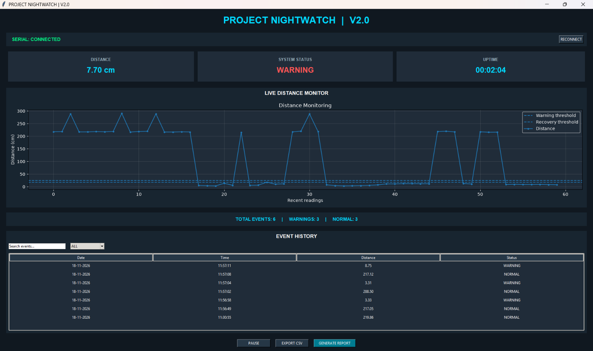

# PROJECT NIGHTWATCH V2.0

### Arduino and Python-Based Real-Time Proximity Monitoring System

An educational embedded systems project that combines an Arduino Uno, an HC-SR04 ultrasonic sensor, and a Python desktop dashboard to monitor object distance, display alerts, and record events.

## Dashboard Preview



## Features

- Real-time distance measurement using HC-SR04.
- LED-based proximity warning indicator.
- Python desktop dashboard built with Tkinter.
- Live distance visualization using Matplotlib.
- Warning and recovery thresholds with hysteresis.
- Three-consecutive-reading confirmation before status changes.
- Searchable and filterable event history.
- Automatic CSV event logging.
- CSV export and text report generation.
- Serial connection indicator.
- Pause and resume controls.
- System uptime display.

## Hardware Components

- Arduino Uno R3
- HC-SR04 ultrasonic sensor
- LED
- 220–330 Ω resistor
- Jumper wires
- USB cable

## Circuit Connections

| Component | Arduino Pin |
|---|---|
| HC-SR04 VCC | 5V |
| HC-SR04 GND | GND |
| HC-SR04 TRIG | D5 |
| HC-SR04 ECHO | D6 |
| LED Anode (+) | D10 through resistor |
| LED Cathode (-) | GND |

## Detection Logic

The Python dashboard uses two thresholds:

- **Warning:** 18 cm or less.
- **Recovery:** 25 cm or more.
- **Confirmation:** 3 consecutive readings before changing system status.

The gap between warning and recovery thresholds helps prevent rapid status changes when measurements fluctuate near the threshold.

## Software Requirements

- Python 3
- Arduino IDE
- pyserial
- matplotlib
- Tkinter

Install the required Python packages:

```bash
py -m pip install -r requirements.txt
```

## How to Run

1. Connect the Arduino Uno to your computer.
2. Open `arduino/nightwatch.ino` in Arduino IDE.
3. Verify the circuit connections.
4. Upload the Arduino sketch.
5. Close the Arduino Serial Monitor.
6. Install the Python dependencies.
7. Open `nightwatch_v2.py`.
8. Configure the correct Arduino COM port in the Python code.
9. Run the Python application.

## Repository Structure

```text
project-nightwatch/
│
├── arduino/
│   └── nightwatch.ino
│
├── README.md
├── dashboard.png
├── nightwatch_v2.py
├── requirements.txt
└── .gitignore
```

## Project Purpose

This project was developed as a hands-on learning experience in:

- Embedded systems
- Arduino programming
- Python development
- Serial communication
- Sensor integration
- Data visualization
- Event logging and monitoring

## Future Improvements

- Improved sensor diagnostics.
- Additional hardware indicators.
- More detailed monitoring analytics.
- Enhanced dashboard customization.
- A documented audible alert using appropriately rated hardware.

## Disclaimer

Project Nightwatch is an educational prototype intended for learning and demonstration. It is not a certified security, safety, or intrusion-detection system.

## Author

Developed by **Dhanush Vivek**.
